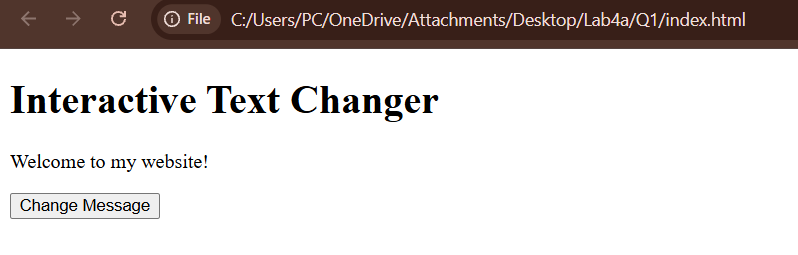
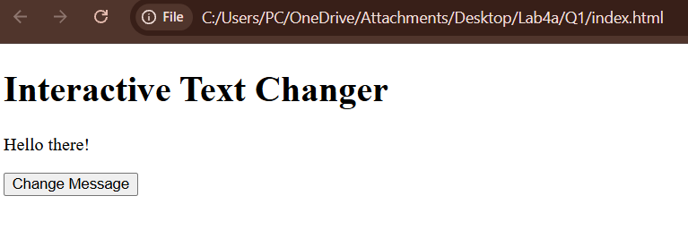
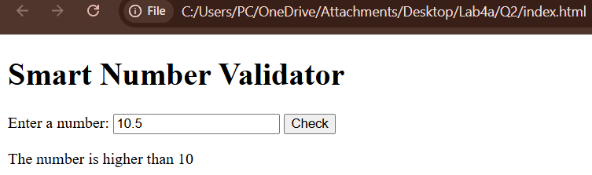
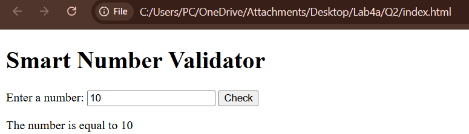
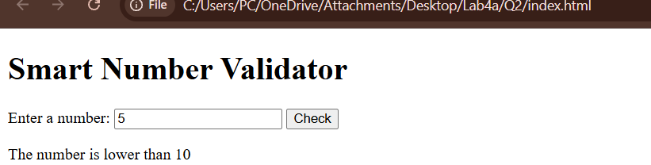
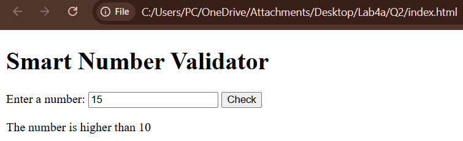
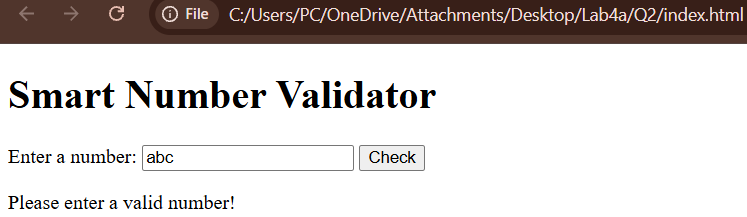
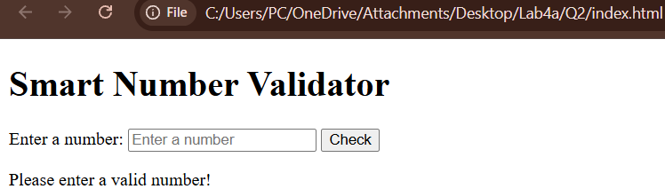
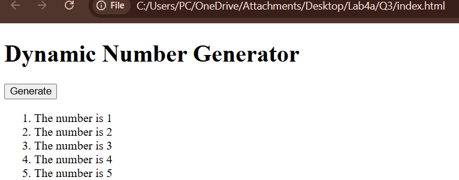

# BIC21203 Lab 4a - Client-Side Scripting (JavaScript)

**Name:** Muhammad Hydher Hykal Bin Yahya

**Student ID:** AI240095

## Introduction

This repository contains the solutions for Lab 4a: Client-Side Scripting (JavaScript) for BIC21203 Web Development.

The lab focuses on JavaScript functions, event handling, input validation, loops and DOM manipulation.

## Questions

### Question 1 - Interactive Text Changer
A webpage that changes the paragraph text from "Welcome to my website!" to "Hello there!" when the button is clicked.

## Question 1 Output

### Question 2 - Smart Number Validator
A webpage that accepts a number and checks whether it is lower than, higher than or equal to 10. It also validates invalid inputs.

## Question 2 Output

### Question 3 - Dynamic Number Generator
A webpage that generates an ordered list from 1 to 5 using a JavaScript for loop and DOM manipulation.

## Question 3 Output

## How to Run

1. Download or clone this repository.
2. Open the Q1, Q2 or Q3 folder.
3. Open the index.html file using a web browser.
4. Follow the instructions on each webpage to test its functionality.

## Technologies Used

- HTML5
- JavaScript
- Visual Studio Code
- Google Chrome

## Conclusion

This lab provided practical experience in using JavaScript to create interactive web pages. It helped develop an understanding of functions, events, conditions, loops and DOM manipulation.
